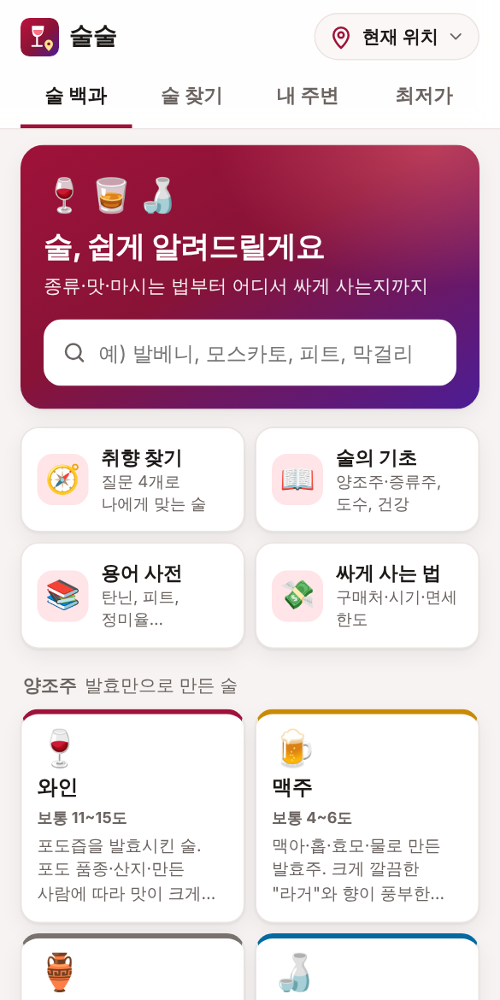
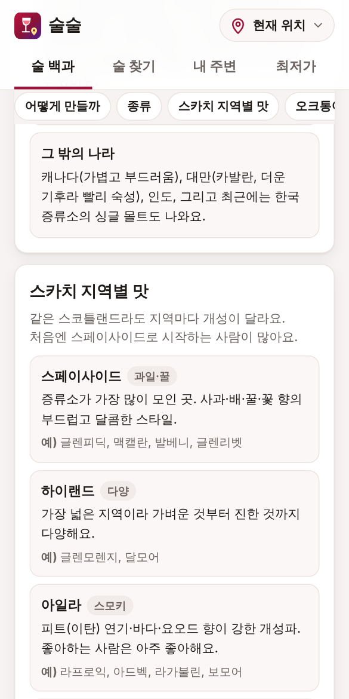
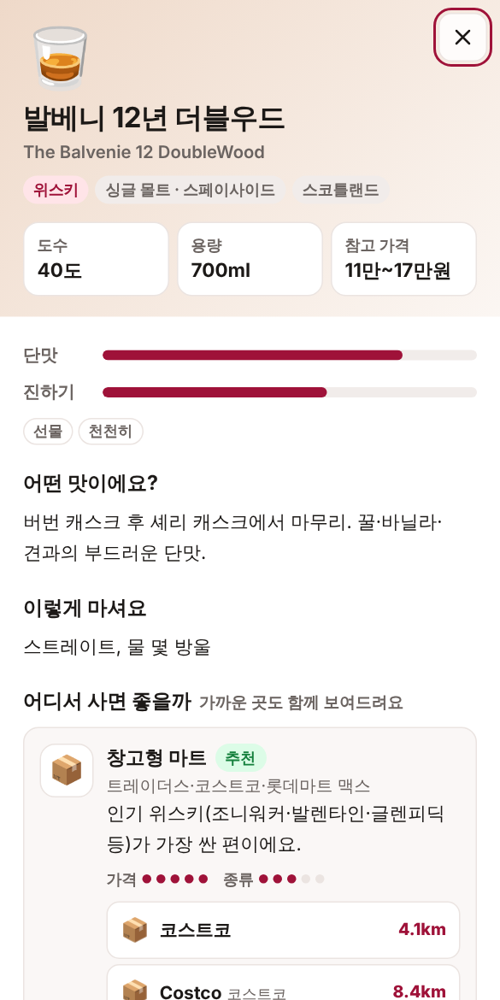
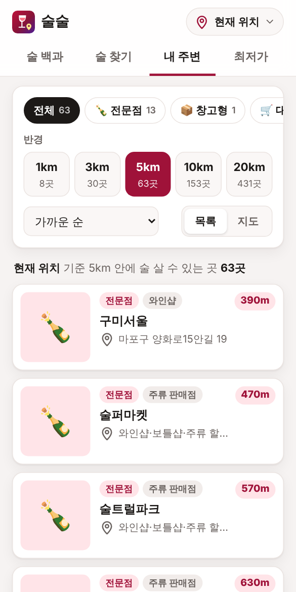
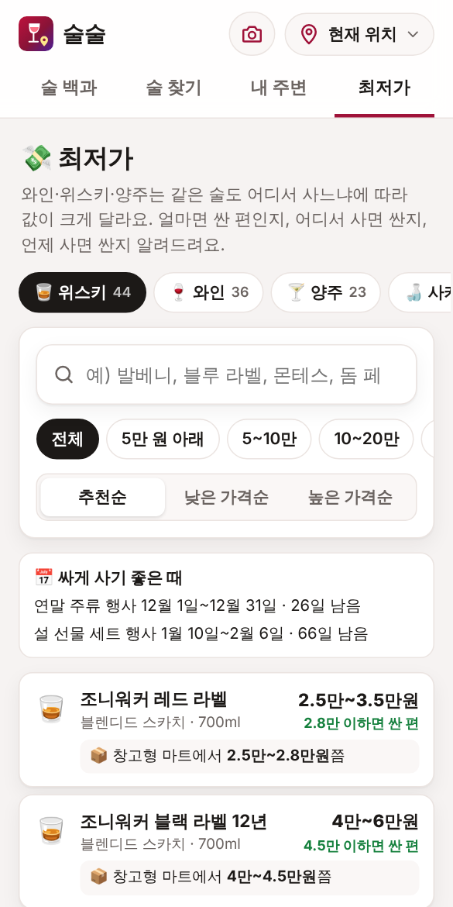

# 술술 · 술 백과와 내 주변 최저가

와인·위스키·맥주·막걸리처럼 **일반인이 잘 모르는 술을 쉽게 설명**하고,
**내 근처 어디에서 싸게 살 수 있는지**, **특정 술은 어디로 가야 파는지**를 알려주는 웹앱입니다.
**술병 사진을 찍으면 어떤 술인지 알아보고** 이름·종류·맛·마시는 법·가격대까지 설명해 줍니다. **유료 API 없이 무료**로 동작합니다.
휴대폰에서 홈 화면에 추가해 앱처럼 쓸 수 있습니다(PWA). 위치 지정 화면은 [어디갈까](https://github.com/kts4u1/Tour) 앱의 것을 그대로 가져왔습니다.

| 술 백과 | 종류별 설명 | 제품 상세 | 내 주변 | 최저가 |
| --- | --- | --- | --- | --- |
|  |  |  |  |  |

모든 기능이 **API 키 없이** GitHub Pages 로 무료 배포됩니다. 사진 분석은 휴대폰 안에서 바로 되고,
Cloudflare 정보를 넣으면 **Cloudflare Workers AI 무료 할당량**으로 더 똑똑하게 분석합니다 → [사진 분석 방법](#사진-분석-방법-모두-무료)

## 주요 기능

### 📷 사진으로 술 알아보기 (무료)
- **사진 찍기 / 앨범에서 고르기** (최대 3장: 앞 라벨 + 뒷면 한글 수입사 스티커를 같이 찍으면 더 정확)
- 두 가지 방법 모두 무료이고, 쓸 수 있는 쪽을 자동으로 고릅니다 ([자세히](#사진-분석-방법-모두-무료))
  - **무료 AI**: Cloudflare Workers AI(하루 무료 할당량)가 사진을 보고 설명 — 목록에 없는 술도 알아봄
  - **기기 안 분석**: 휴대폰 안에서 **바코드**와 **라벨 글자(OCR)** 를 읽어 **브랜드 사전 745곳**·술 백과와 맞춤 — 서버 없이, 사진을 어디에도 보내지 않음
- 무료 AI 의 하루 사용량이 끝나거나 응답이 없으면 **자동으로 기기 안 분석**으로 바꿈. "사진을 서버로 보내지 않고 기기 안에서만 분석" 선택도 있음
- 결과: 한국어/원어 이름, 생산자, 종류·세부 스타일, 나라·지역, 숙성 연수·빈티지, 도수·용량, 소개,
  **향·맛**, 단맛·진하기, **마시는 온도·잔·방법**(하이볼 비율 등), 어울리는 음식(한식 포함),
  **예상 가격대**, 어디서 사면 좋은지 + **내 주변 가장 가까운 매장**, 비슷한 술(누르면 바로 알아보기), 보관법
- **판단 정도**(정확히 / 대체로 / 짐작)와 근거(읽은 바코드·라벨 글자, 분석 방법)를 함께 보여 줘서 틀렸는지 확인할 수 있음
- 브랜드를 몰라도 라벨의 지역·품종으로 알려 줌 (예: "보르도 레드 와인 (생산자 확인 필요)")
- 앱 목록에 같은 제품이 있으면 연결, 소주·맥주·막걸리는 참가격 실제 판매가도 함께
- **이름으로 알아보기**: 검색창에 "몬테스 알파", "glenfiddich"처럼 적으면 브랜드 사전 결과와 "자세히 알아보기" 버튼 (백과·술 찾기 어디서나).
  - 브랜드 사전에 있는 이름은 **사전으로 바로** 보여 줌 (정확하고 무료 AI 사용량을 안 씀). 결과의 "무료 AI에게 더 자세히 묻기"로 AI 설명도 볼 수 있음
  - 사전에 없는 이름만 무료 AI 에게 물어봄
  - "글렌"처럼 짧게 적으면 비슷한 브랜드를, "코냑"·"IPA"·"칠레"처럼 적으면 그 종류의 브랜드를 골라 볼 수 있음
  - 숙성 연수가 높은 위스키(18·21년 이상)와 코냑 XO 는 가격대를 올려 잡음
- **최근 알아본 술** 20개를 이 기기에 저장 (사진은 작은 미리보기만)
- 술이 아니거나 흐린 사진이면 다시 찍는 요령을 알려 줌

### 술 백과
- 14가지 술: 와인, 위스키, 맥주, 소주, 전통주, 사케, 브랜디·코냑, 보드카, 진, 럼, 데킬라, 리큐르, 중국술, 하이볼·칵테일
- 술마다: 어떻게 만드는지, 종류, (와인) 포도 품종·나라별 특징, (위스키) 스카치 지역·오크통, 맛 표현,
  맛있게 마시는 온도·잔, 한식과 어울리는 음식, 라벨 읽는 법, 가격대 가이드, 처음이라면 무엇부터, 보관, 자주 묻는 질문
- 그 술을 **어디서 사면 좋은지**(창고형 마트·전문점·대형마트·앱 스마트오더·면세점 …)와 **내 주변 가장 가까운 곳**
- **취향 찾기**: 질문 4개(맛·도수·마시는 법·예산)로 제품 추천
- **용어 사전** 89개 (탄닌, 피트, 캐스크 스트렝스, 정미율, 생막걸리 …), **술의 기초**, **싸게 사는 법**(구매처·시기·면세 한도·스마트오더)
- 술 이름·별명·영어·용어 통합 검색 (예: "맥켈란"처럼 흔히 틀리는 표기도 찾음)

### 술 찾기
- 대표 제품 128개: 이름으로 찾거나 종류·가격순으로 보기
- 제품 상세: 도수·용량·**참고 가격대**, 단맛·진하기, 맛 설명, 마시는 법, 어울리는 음식
- **어디서 사면 좋을까**: 그 술에 맞는 구매처 순서와 이유, 구매처마다 **내 주변 가장 가까운 매장 2곳**
- 소주·맥주·막걸리는 **실제 판매 가격**(참가격)으로 "가장 싼 곳 1,240원 · 이마트 신촌점 1.2km"처럼 표시
- 와인·위스키·양주는 **얼마면 싼 편인지**, **판매처별 대략적인 가격과 가까운 매장**, **싸게 사기 좋은 때**, 오늘 가격을 볼 수 있는 사이트 링크
- 목록에 없는 술은 네이버 가격 검색, 카카오맵·네이버지도의 "근처 보틀샵" 검색으로 연결

### 내 주변
- 현재 위치(GPS) 또는 도시 선택, 지도에서 직접 고른 위치 기준
- 반경 **1 / 3 / 5 / 10 / 20km**, 종류: 주류 전문점(**와인샵 · 보틀샵 · 주류 할인점 · 전통주**로 나눠 고르기) · 창고형 마트 · 대형마트 · 동네 슈퍼(SSM) · 백화점 · 양조장
- 동네 술 가게는 OpenStreetMap 에 소상공인 상가정보의 "주류 소매업" 가게를 더해 전국 약 1,350곳 (서울시청 5km 안에 130여 곳), 주소도 함께
- 정렬: 가까운 순 · 싸게 사기 좋은 순 · 종류 많은 순, 목록 / 지도 보기
- 매장 상세: 길찾기(카카오맵), 카카오맵·네이버지도, 전화, 영업시간, 참가격 조사 매장이면 그 매장의 소주·맥주·막걸리 가격
- 목록에 없는 가게를 위해 "**마포구 동교동 와인샵**"처럼 동네 이름을 붙인 카카오맵·네이버지도 검색 링크

### 최저가
와인·위스키·양주는 공공 가격 자료가 없어서, 직접 정리한 **참고 가격대**로 "어디서 얼마면 싼지"를 알려 줍니다.
- 위스키 44 · 와인 36 · 양주 23 · 사케·전통주 8개 (발렌타인 21·30년, 조니워커 블루·18년, 맥캘란 18년, 히비키, 야마자키 12년, 블랑톤, 티처스, 몬테스 퍼플 엔젤, 오퍼스 원, 돔 페리뇽 …)
  - 128개 중 125개의 참고 가격을 **2026년 11월에 공개된 판매가**(마트 앱·주류 가격 비교 사이트·기사)로 다시 맞춤 (예: 발베니 12년 코스트코·트레이더스 9만 원대 중반).
    소주·맥주·막걸리는 한국소비자원 참가격(전국 매장·편의점 조사 가격) 기준. 제품 화면에 언제 확인한 값인지 표시
- 제품마다 "**10.5만 원 이하면 싼 편**"(참고 가격대의 아래쪽 4분의 1) · 보통 · 비싼 편 기준
- **판매처별 대략적인 가격**: 창고형 마트 → 대형마트 행사 → 대형마트 평소 → 주류 할인점 → 와인샵·보틀샵 → 편의점 → 백화점 순서로,
  판매처마다 **내 주변 가장 가까운 곳**("가까운 곳: 코스트코 8.7km")도 함께. 전통주는 온라인 주문(택배)도
- **면세점 안내**: 1인 2병(합계 2L·400달러) 면세, 정가는 시중보다 비쌀 때도 있다는 주의
- **싸게 사기 좋은 때**: 다음 명절 선물 세트 행사(설·추석 4주 전부터)와 연말 행사까지 며칠 남았는지, 와인 장터(봄·가을)
- **오늘 가격 확인하기**: 위스키와치(면세점·코스트코·트레이더스 가격), 데일리샷(주변 매장 픽업 가격), 네이버 가격 검색으로 바로 연결 (링크만, 가격을 가져오지 않음)
- 가격대(5만 원 아래 · 5~10만 · 10~20만 · 20만 원 이상), 이름 검색(앱 목록에 없는 술은 **브랜드 사전 745곳의 가격대**), 추천순 · 낮은 가격순 · 높은 가격순
- **가까운 싸게 사기 좋은 곳**: 위스키는 창고형 마트 · 주류 할인점 · 보틀샵, 와인은 창고형 마트 · 와인샵 · 대형마트에서 가장 가까운 곳

**소주·맥주·막걸리** 칸은 한국소비자원 **참가격**이 매주 금요일 조사한 전국 약 400개 대형마트·SSM·백화점의 실제 가격입니다.
- 참이슬·처음처럼·카스·테라·하이트·장수/국순당 막걸리 등: 내 주변 싼 순 / 가까운 순, 주변 보통 가격 대비 얼마나 싼지, 할인·1+1 표시
- **편의점 본사 가격**(GS25·CU·세븐일레븐·이마트24 전국 공통)과 비교: "편의점보다 660원 ↓"
- 반경 안에 조사 매장이 없으면 가장 가까운 곳을 자동으로 보여 줌

## 데이터는 어디서 오나요

| 데이터 | 출처 | 갱신 |
| --- | --- | --- |
| 술 설명·제품·용어·구매처 가이드 | 직접 작성 (`public/js/content/`) | 직접 고침 |
| 와인·위스키·양주 가격 | 참고 가격대 — 직접 작성(`products.js`), 2026년 11월 공개 판매가로 확인(`checked`) · 명절 날짜: 한국천문연구원 음력 자료 | 직접 고침 |
| 소주·맥주·막걸리 실제 가격 | 한국소비자원 참가격 — [세일레이더](https://github.com/kts4u1/Sale-and-Discount) 앱이 매일 받아 GitHub Pages 에 올리는 스냅샷에서 술만 골라냄 | 매일 (조사는 매주 금요일) |
| 술 살 수 있는 곳 위치 | [OpenStreetMap](https://www.openstreetmap.org) (전국 마트·백화점·주류 전문점·양조장 약 2,100곳) + 참가격 조사 매장 | 매일 |
| 동네 술 가게 (와인샵·보틀샵·주류 할인점·전통주) | [소상공인시장진흥공단 상가(상권)정보](https://www.data.go.kr/data/15083033/fileData.do) — 업종이 "주류 소매업"인 가게와 이름에 와인·주류·위스키 등이 들어간 소매점 약 1,240곳 (이용허락범위 제한 없음) — `npm run data:shops` | 분기 (새 파일이 나오면 자동으로) |
| 사진 분석 (기기 안) | [Tesseract.js](https://github.com/naptha/tesseract.js) 글자 인식(영어·한국어) · [zxing-wasm](https://github.com/Sec-ant/zxing-wasm) 바코드 · 브랜드 사전(`public/js/content/brands.js`, 직접 작성) | - |
| 세계 술 데이터 | [X-Wines](https://github.com/rogerioxavier/X-Wines) 와인 10만 개 (CC0) · [위키데이터](https://www.wikidata.org) 생산자 (CC0) — `npm run data:world` | 직접 받을 때 |
| 바코드 제품 정보 | [Open Food Facts](https://world.openfoodfacts.org) 공개 제품 DB (무료, 키 없음) | 요청할 때 |
| 사진 분석 (무료 AI) | Cloudflare Workers AI (Llama 4 Scout, 하루 무료 할당량) — Cloudflare Worker 를 거쳐 호출 | 요청할 때 |
| 동네 이름 | OpenStreetMap Nominatim (위치가 바뀔 때만 한 번, 이 기기에 저장) | - |
| 지도 | Leaflet + OpenStreetMap 타일 | - |

### 왜 카카오 로컬 API 를 쓰지 않았나요?

카카오 디벨로퍼스 [운영정책](https://developers.kakao.com/terms/latest/ko/site-policies) 제4조가 **"담배/주류 관련 서비스"를 금지**하고,
주류는 서비스 안에 **본인확인 기관을 통한 성인인증**을 넣고 카카오의 별도 검토를 받아야만 예외로 허용합니다
(카카오 로그인은 성인인증 수단으로 인정되지 않음). 위반하면 API 가 차단되고 **같은 계정에 연결된 다른 앱까지 막힐 수 있습니다.**
어디갈까·한끼 최저가·세일레이더가 쓰는 카카오 키를 지키기 위해, 매장 위치는 OpenStreetMap 으로 가져오고
카카오맵·네이버지도는 API 가 아닌 일반 웹 링크(검색·길찾기)로만 연결했습니다.

## 빠른 시작

Node.js 20.12 이상이 필요합니다.

```bash
npm install
```

```bash
npm start
```

브라우저에서 http://localhost:3000 을 엽니다. 저장소에 데이터 파일(`data/`)이 들어 있어서 바로 동작합니다.

데이터를 최신으로 받으려면 (2~3분, 인터넷 필요):

```bash
npm run data:update
```

받다가 실패하면 기존 파일을 그대로 둡니다. `-- --only=prices` 또는 `-- --only=stores` 로 하나만 받을 수 있습니다.

## GitHub Pages 에 배포하기

1. 저장소 **Settings › Pages › Build and deployment › Source** 를 **GitHub Actions** 로 바꿉니다.
2. **Actions › GitHub Pages 배포 › Run workflow** (또는 기본 브랜치에 push).
3. 끝나면 `https://kts4u1.github.io/drink/` 에서 열립니다.

그 뒤로는 **매일 새벽 6시 23분(한국 시간)** 에 최신 가격·매장 데이터로 자동 재배포됩니다. Secrets 는 필요 없습니다.
데이터 받기가 실패하면 저장소에 들어 있는 데이터로 배포합니다.

내 PC 에서 배포본 그대로 만들어 보기: `npm run build` → `dist/` 폴더.

## 사진 분석 방법 (모두 무료)

| | 기기 안 분석 (기본, 설정 없음) | 무료 AI (Cloudflare 정보를 넣으면) |
| --- | --- | --- |
| 어떻게 | 휴대폰에서 바코드·라벨 글자를 읽고 브랜드 사전 745곳·술 백과와 맞춤 | Cloudflare Workers AI(Llama 4 Scout)가 사진에서 제품 이름을 읽고, 브랜드 사전에 있으면 사전으로, 없으면 AI 가 한국어로 설명 |
| 잘하는 것 | 유명 브랜드, 한글 수입사 스티커, 바코드가 있는 술. 사진을 밖으로 보내지 않음 | 사전에 없는 술, 글자가 흐리거나 장식체인 라벨 |
| 약한 것 | 사전에 없는 작은 와이너리는 "보르도 레드 와인"처럼 종류까지만. 장식 글씨는 못 읽을 때가 많음 | 20~50초 걸림, 하루 무료 사용량이 있음, 사전에 없는 술의 설명·가격은 틀릴 때가 있음 |
| 비용 | 0원 (처음 한 번 글자 인식 파일 약 9MB 를 이 사이트에서 받아 저장) | 0원 (무료 할당량 안에서만) |

화면은 무료 AI 가 켜져 있으면 먼저 쓰고, **하루 사용량이 끝나거나 1분 넘게 응답이 없으면 자동으로 기기 안 분석으로** 바꿉니다.
그래서 아무 설정 없이 배포해도 사진 분석이 됩니다.

### 세계 술 데이터 (와인 10만 개 · 생산자 3만 5천 곳)
세상의 모든 술을 사람이 하나하나 설명할 수는 없어서, 세 겹으로 찾습니다.

1. **브랜드 사전** (`public/js/content/brands.js`, 직접 쓴 한국어 설명) — 한국에서 많이 보이는 브랜드
2. **세계 술 데이터** (`data/world/`) — 사전에 없으면 여기서. 와인은 품종·산지·바디감·산도·어울리는 음식까지,
   와이너리·양조장·증류소는 어느 나라·지역인지와 그 술 종류의 일반 설명
3. **무료 AI** — 둘 다 없을 때만 (지어내지 않게 사진에서 읽은 정보를 같이 넘김)

| 데이터 | 내용 | 라이선스 |
| --- | --- | --- |
| [X-Wines](https://github.com/rogerioxavier/X-Wines) | 62개 나라 와인 100,646개 · 와이너리 30,190곳 · 산지 2,160곳 · 품종 777종 | CC0 |
| [위키데이터](https://www.wikidata.org) | 와이너리·맥주 양조장·사케 양조장·위스키 증류소·(생산품이 확인된) 증류소 약 4,700곳 | CC0 |

X-Wines 를 쓴 결과물은 논문 인용이 필요합니다: de Azambuja, R.X.; Morais, A.J.; Filipe, V. *X-Wines: A Wine Dataset for Recommender Systems and Machine Learning.*
Big Data Cogn. Comput. 2023, 7, 20. https://doi.org/10.3390/bdcc7010020

데이터는 작은 조각 파일로 나눠 두었습니다 (`meta.json` + 이름 조각 `k/` 약 2,900개 + 와인 조각 `w/` 202개).
화면과 Worker 는 라벨 글자에 나온 단어의 조각만 받아서 (보통 10개 안팎, 수십 KB), 휴대폰 데이터와 Worker 무료 플랜의 짧은 계산 시간 안에 들어갑니다.
"Margaux"처럼 산지·품종 이름이나 "reserve"·"bouteille" 같은 라벨에 흔한 말만으로는 생산자를 정하지 않습니다.

다시 받기 (1분 안팎, 인터넷 필요. 실패하면 기존 파일을 그대로 둠):

```bash
npm run data:world
```

더 넓히려면: 위스키·코냑은 공개된 큰 목록이 드물어 브랜드 사전에 직접 더하는 것이 가장 정확합니다.
[LWIN](https://www.liv-ex.com/lwin/)(와인·증류주 20만 개, Creative Commons, 무료지만 받으려면 신청서 작성)이나
[수입식품정보마루](https://impfood.mfds.go.kr)의 수입 신고 제품명(한글 이름)도 후보입니다.

### 기기 안 분석은 이렇게 알아봐요
1. **바코드**: 브라우저의 BarcodeDetector(없으면 zxing-wasm)로 EAN/UPC 바코드를 읽고, [Open Food Facts](https://world.openfoodfacts.org) 에서 제품 이름을 찾습니다.
2. **라벨 글자**: Tesseract.js(영어+한국어)로 글자를 읽습니다. 글자 인식 파일은 `vendor/` 에 같이 배포되고 처음 한 번만 받습니다.
3. **맞추기** (`public/js/lib/label.js`, 사전에 없으면 `public/js/lib/world.js` 의 세계 술 데이터): 읽은 글자에서 도수·용량·숙성 연수·빈티지·포도 품종·지역을 뽑고,
   브랜드 사전과 맞춥니다. 글자 인식 오타(GLENFIDICH)와 띄어쓰기(라 프 로 익)도 견디고, "Terra"가 들어간 와인을 맥주 테라로 착각하지 않게 종류 단서를 함께 봅니다.
4. 브랜드·백과·제품 목록의 내용으로 설명·마시는 법·음식·가격대를 채웁니다.

브랜드를 더 넣으려면 `public/js/content/brands.js` 에 한 줄 추가하면 됩니다(`npm test` 가 겹치는 이름을 찾아 줌).

### 무료 AI 는 이렇게 알아봐요
실제로 시험해 보니 이 무료 모델은 **사진을 붙이면 라벨은 정확히 읽지만 한국어가 깨져서**("위스키" → "위하벗") 나왔습니다.
그래서 두 단계로 나눴습니다 (`server/identify/workers-ai.js`).
1. 사진 → **영어로** 제품 이름·라벨 글자·도수·숙성만 짧게 읽기 (예: "Johnnie Walker Black Label 12 Year Old")
2. 그 이름이 **브랜드 사전에 있으면 사전으로** 한국어 설명 (정확하고, AI 를 한 번 덜 부름).
   없으면 그 이름으로 AI 에게 한국어 설명을 받고, 깨진 글자는 지움
3. 도수·용량·숙성·라벨 글자는 사진에서 읽은 값으로 덮어씀

### 무료 AI 켜기 (선택)
화면(GitHub Pages)은 정적 파일이라 **Cloudflare Worker**(`sulsul-api`)가 Workers AI 를 대신 부릅니다. 어디갈까 앱과 같은 방식입니다.

```
휴대폰 ── 사진 ──▶ Cloudflare Worker (sulsul-api) ──▶ Workers AI (무료 하루 할당량)
  ▲   GitHub Pages 화면      CORS·분당 제한·하루 한도·결과 저장(KV)
  └──────────── 결과 JSON ◀──────────────────────────────┘
```

1. **Cloudflare 정보** (어디갈까 앱에 넣은 것과 같은 값)
   - **계정 ID**: Cloudflare 대시보드 › Workers 및 Pages 오른쪽의 계정 ID
   - **API 토큰**: 내 프로필 › API 토큰 › 토큰 생성 › **Cloudflare Workers 편집** 템플릿 (Workers KV 편집 권한 포함).
     배포가 권한 오류로 실패하면 토큰에 **Workers AI** 권한을 추가하세요.
2. 저장소 **Settings › Secrets and variables › Actions › New repository secret** 에 넣기

   | Name | 값 |
   | --- | --- |
   | `CLOUDFLARE_API_TOKEN` | API 토큰 |
   | `CLOUDFLARE_ACCOUNT_ID` | 계정 ID |

3. **Actions › GitHub Pages 배포 › Run workflow**. 워크플로가 Worker 를 배포하고, 그 주소를 화면의 `config.json` 에 넣어 GitHub Pages 를 다시 배포합니다.
   술 찾기 탭 맨 위에 "🆓 Cloudflare 무료 AI로 분석해요"가 보이면 켜진 것입니다.

처음 Workers 를 쓰는 계정이면 Cloudflare 대시보드에서 workers.dev 서브도메인을 먼저 정하라고 나올 수 있습니다.
Worker 주소를 직접 정하고 싶으면 저장소 **Settings › Secrets and variables › Actions › Variables** 에 `API_BASE`(예: `https://sulsul-api.내이름.workers.dev`)를 넣으세요.

### 돈이 들지 않게 하는 장치
- Workers AI 는 **하루 10,000 뉴런까지 무료**입니다(매일 0시 UTC = 한국 시간 오전 9시에 다시 채워짐).
  **Workers 무료 플랜**이면 넘었을 때 돈이 나가는 대신 오류가 나고, 화면은 그때 기기 안 분석으로 바꿉니다.
- ⚠️ Cloudflare 계정이 **Workers 유료 플랜(월 5달러)** 이면 넘은 만큼 청구될 수 있습니다(1,000 뉴런당 0.011달러).
  그래서 **하루 한도** `DAILY_LIMIT`(기본 50번, 한국 시간 기준)를 낮게 잡아 두었습니다. 사용량은 대시보드 › AI › Workers AI 에서 볼 수 있습니다.
- **IP 마다 1분에 6번**까지 (Cloudflare Rate Limiting)
- **같은 사진·같은 이름은 7일 동안 저장된 결과**를 다시 써서 한도에 세지 않음 (술이 아니라고 나온 결과는 저장 안 함)
- **허용한 주소의 화면만** API 를 부를 수 있음 (`ALLOWED_ORIGINS`, 기본 `https://kts4u1.github.io`)
- 사진은 화면에서 1600px 로 줄여 보내고, Worker 는 사진을 저장하지 않습니다.

### (선택) 유료 Claude 로 바꾸기
더 정확한 분석이 필요하면 `wrangler.jsonc` 의 `AI_PROVIDER` 를 `anthropic` 으로 바꾸고 GitHub Secret `ANTHROPIC_API_KEY` 를 넣으면
Claude(기본 `claude-opus-5-5`, 사진 1장에 약 100~140원)로 분석합니다. 이때는 [Claude Platform 콘솔](https://platform.claude.com)에서 월 사용 한도를 꼭 정해 두세요.
내 PC 에서는 `.env` 에 `ANTHROPIC_API_KEY` 를 넣고 `npm start` 하면 됩니다(넣지 않으면 기기 안 분석만 씀).

## 휴대폰에서 사용하기

- **현재 위치(GPS)는 https 주소에서만** 동작합니다(localhost 는 예외). GitHub Pages 주소는 https 라 그대로 됩니다.
- 처음 열면 **만 19세 이상인지** 묻고, 그다음 위치 안내 화면이 나옵니다. 위치 권한을 거부해도 도시를 골라 쓸 수 있습니다.
- 위쪽 📷 버튼을 누르면 어느 화면에서든 바로 카메라가 열립니다.
- 휴대폰 브라우저 메뉴의 **홈 화면에 추가**로 앱처럼 설치됩니다.

## 내용 고치기

| 고칠 것 | 파일 |
| --- | --- |
| 술 종류별 설명 | `public/js/content/categories/*.js` |
| 제품 (참고 가격·도수·맛) | `public/js/content/products.js` |
| 용어 사전 | `public/js/content/glossary.js` |
| 구매처 설명, 술 종류별 추천 구매처 | `public/js/content/channels.js` |
| 술의 기초, 싸게 사는 법 | `public/js/content/guides.js` |

`npm test` 가 빠진 연결(없는 술 종류, 잘못된 구매처 이름, 참가격과 안 맞는 제품 등)을 찾아 줍니다.

## 폴더 구조

```
public/
  index.html, styles.css, sw.js, manifest.webmanifest, icons/
  js/app.js            시작점 · 탭 · 나이 확인
  js/view-guide.js     술 백과 (첫 화면 · 종류별 글 · 용어 사전 · 취향 찾기)
  js/view-find.js      술 찾기
  js/view-nearby.js    내 주변
  js/view-prices.js    최저가 (와인·위스키·양주 가격 안내, 소주·맥주·막걸리 참가격)
  js/api.js            서버 연결 (config.json · 상태 확인)
  js/sheets.js         제품·매장 상세
  js/snap.js           사진으로 술 알아보기 (사진 줄이기 · 무료 AI/기기 안 분석 고르기 · 결과 · 최근 기록)
  js/local-vision.js   기기 안 분석 (바코드 · 글자 인식 · Open Food Facts)
  js/location.js       현재 위치 · 도시 선택 · 위치 권한 안내 (어디갈까 앱에서 가져옴)
  js/map.js            지도 (Leaflet)
  js/place.js          동네 이름 · 카카오맵/네이버지도 링크
  js/lib/              검색 · 거리 · 가격 비교(nearby.js · prices.js) · 취향 추천 · 결과 다듬기 · 라벨 분석(label.js) · 세계 술 데이터 찾기(world.js) (테스트도 이 파일로)
  js/content/          술 백과 콘텐츠 · 브랜드 사전(brands.js)
scripts/
  update-data.js       데이터 받기 (참가격 + OpenStreetMap)
  lib/osm.js           OpenStreetMap 매장 분류
  lib/kca.js           참가격에서 술 고르기
  build.js             GitHub Pages 용 dist/ 만들기
data/                  stores.json (매장), prices.json (참가격 술 가격), world/ (세계 술 데이터 조각)
scripts/update-world.js 세계 술 데이터 받기 (X-Wines + 위키데이터)
server/index.js        개발용 서버 (.env 에 키가 있으면 /api/identify 도)
server/identify/       사진 인식: Workers AI(workers-ai.js) · Claude(claude.js) · JSON 형식(schema.js) · 지시문(prompt.js) · 검사·캐시·한도(handler.js)
worker/index.js        Cloudflare Worker (무료 AI 사진 인식 API)
wrangler.jsonc         Worker 설정 (AI 종류·모델, 하루 한도, 허용 주소)
scripts/ensure-kv.js   Worker 결과 저장소(KV) 만들기
test/                  자동 테스트
```

## 테스트

```bash
npm test
```

OpenStreetMap 매장 분류("케이마트", "이마트24" 같은 이름에 속지 않는지), 참가격 술 상품 고르기("박카스맛 젤리"·"폰테라 버터" 같은 상품 제외),
가짜 스냅샷 서버로 데이터 받기 전체 흐름, 반경 검색·가격 비교·검색·취향 추천, 콘텐츠 연결, 데이터 파일 형식,
**라벨 분석기**(도수·숙성·품종 뽑기, 글자 인식 오타·띄어쓰기, 종류가 어긋난 브랜드 거르기, 바코드 체크 숫자, 브랜드 사전 이름 겹침),
**가짜 Workers AI·가짜 Claude API 서버로 사진 인식 전체 흐름**(요청 모양·JSON 스키마·저장된 결과·하루 한도·무료 사용량 끝·분당 제한·거절·Worker 의 CORS),
그리고 **가격 안내**(싼 편 기준, 판매처별 가격 순서, 명절·연말 행사 날짜 계산, 오늘 가격 링크)를 검사합니다.

## 알아둘 점

- **사진 분석은 틀릴 수 있습니다.** 특히 빈티지·숙성 연수·한정판처럼 라벨의 작은 글자는 놓칠 수 있어,
  결과에 판단 정도와 근거(읽은 글자·바코드)를 함께 보여 줍니다. **예상 가격은 실제 가격이 아니니** 네이버 가격 검색으로 확인하세요.
- 기기 안 분석은 브랜드 사전에 있는 술만 이름까지 알아봅니다. 장식 글씨(필기체·고딕체) 라벨은 글자 인식이 어려워, 뒷면 한글 스티커를 같이 찍는 게 가장 정확합니다.
- 기기 안 분석은 실제 브라우저(Chromium)에서 만든 라벨 사진으로 시험했습니다. 실제 휴대폰 카메라 사진(기울어짐·반사·곡면)은 정확도가 더 낮을 수 있어요.
- 무료 AI 는 실제 Worker 에서 만든 라벨 사진(조니워커 블랙 12년, 라프로익 10년 한글 스티커)으로 시험했습니다. 제품 이름은 정확히 읽었고,
  사전에 없는 술은 AI 가 쓴 한국어 설명·가격이 어색하거나 틀릴 수 있습니다(예: 조니워커 블랙을 2만 원대로).

- **참고 가격대는 직접 넣은 대략적인 값**입니다. 2026년 11월에 공개된 판매가로 확인했고(제품마다 `checked`), 토키·상그레 데 토로·지평 막걸리 3개는 자료를 못 찾아 짐작한 값이에요.
  가격은 몇 달 만에도 바뀌니(2025년부터 위스키 출고가 인하 중) 반년에 한 번쯤 다시 확인하면 좋아요. 매장·행사·환율·수입사마다 크게 다르니,
  틀린 값이 보이면 `products.js` 에서 고쳐 주세요. "싼 편" 기준도 이 값으로 정해집니다.
- 와인·위스키는 공공 가격 자료가 없어 **매장별 실제 가격은 알 수 없습니다.** 판매처별 가격은 참고 가격대를 판매처 순서대로 나눈 짐작이에요.
  오늘 가격은 위스키와치·데일리샷·네이버 링크로 확인하게 했습니다. 이 사이트들은 API 가 없고 약관이 가격 수집을 막아서, 가격을 가져오지 않고 링크만 겁니다.
- 명절 날짜(`public/js/lib/prices.js` 의 `HOLIDAYS`)는 2028년 추석까지 들어 있어요. 그 뒤로는 날짜를 이어 적어야 명절 행사가 안내됩니다(없으면 연말 행사만).
- 참가격은 **매주 금요일 조사한 가격**이라 오늘 매장 가격과 다를 수 있고, 전국 약 400개 매장만 조사합니다(편의점은 본사 가격).
- 참가격 자료는 세일레이더 앱의 공개 스냅샷에 기대고 있습니다. 세일레이더의 자료 형식이 바뀌면 받기를 멈추고 기존 파일을 지킵니다(`version` 확인).
- OpenStreetMap 에는 동네 주류 전문점이 전국 100여 곳뿐이라 **소상공인 상가정보의 "주류 소매업" 가게**를 더했습니다 (전국 약 1,240곳).
  다만 상가정보는 분기마다 갱신되고, 사업자가 다른 업종(예: 슈퍼마켓)으로 등록한 가게는 이름에 와인·주류 같은 말이 없으면 빠집니다.
  폐업한 가게가 남아 있을 수도 있어서, 매장 화면에 지도 앱 링크와 확인 안내를 함께 보여 줍니다.
- 나이 확인은 "만 19세 이상인가요?"를 묻는 확인 창이며 본인인증은 아닙니다. 이 앱은 술을 팔지 않고 정보만 보여 줍니다.
- 지도 타일과 Nominatim 은 OpenStreetMap 공용 서버입니다. 사용자가 많아지면 [타일 정책](https://operations.osmfoundation.org/policies/tiles/)·[Nominatim 정책](https://operations.osmfoundation.org/policies/nominatim/)에 맞춰 다른 서비스로 바꾸는 것이 좋습니다.

## 다음에 해 볼 만한 것

- 브랜드 사전 늘리기 (지금 745곳: 위스키 226 · 와인 208 · 맥주 79 · 리큐르 41 · 전통주 39 · 사케·쇼추 30 · 브랜디 23 · 진 21 · 보드카 18 · 데킬라 16 · 럼 15 · 소주 11 · 중국 술 13 · 캔 하이볼 5)
- 마셔 본 술 기록·별점, 찜 목록
- 제품 사진 (저작권 문제 없는 이미지로)
- 위스키와치 같은 가격 비교 사이트와 제휴하거나 공식 API 가 생기면 실제 매장 가격 보여 주기
- 앱스토어 출시: [Capacitor](https://capacitorjs.com) 로 웹앱 감싸기
